<!-- Generated by scripts/render_cards.py. Edit profile.json, not this file. -->

  

  
  <a href="https://github.com/YashasRajR?tab=repositories"></a>
  

  

  <a href="https://github.com/YashasRajR/CodeInterview_AI"></a>
  <a href="https://github.com/YashasRajR/alternative_credit_evaluation_tool"></a>
  <a href="https://github.com/YashasRajR/Real_Time_Sign_Language_Translator"></a>
  <a href="https://github.com/YashasRajR/chest-xray-pneumonia-detection-System"></a>

  <a href="https://github.com/YashasRajR/AWS_SCD_guni"></a>
  <a href="https://github.com/YashasRajR/web_arithmetic_calculator"></a>
  <a href="https://github.com/YashasRajR/human-behavior-tracking-system"></a>
  <a href="https://github.com/YashasRajR/career_dendrogram_system"></a>
  <a href="https://github.com/YashasRajR/banking_operations_simulation"></a>
  <a href="https://github.com/YashasRajR/Guni-redirection"></a>
  <a href="https://github.com/YashasRajR/AWS_SBG_GUNI-website"></a>
  <a href="https://github.com/YashasRajR/CropIQ"></a>
  <a href="https://github.com/YashasRajR/ai-music-recommendation-system"></a>
  <a href="https://github.com/YashasRajR/Sentiment_Analysis_Dashboard"></a>
  <a href="https://github.com/YashasRajR/Portfolio_website"></a>
  <a href="https://github.com/YashasRajR/YashasRajR-training-baseline"></a>

  

